<h1 align="center">Arthur Queiroz</h1>

  Estudante de Ciência da Computação na CESAR School e dev web freelancer. 
  Sou de Maceió e moro em Recife.

  
  
  

---

## Sobre mim

Curso Ciência da Computação na CESAR School, com formatura prevista para 2028, e faço sites como freelancer. No back-end uso Python com Django ou FastAPI. No front, React com TypeScript, ou HTML, CSS e JavaScript puro quando o projeto pede algo mais simples.

Boa parte do que está aqui começou com um problema de alguém. Uma rádio que precisava de site novo, uma amiga que vende roupa pelo WhatsApp, e eu querendo entender para onde vai o meu dinheiro.

Também sou monitor de Infraestrutura de Software na faculdade e estou aberto a oportunidades de estágio.

## Ferramentas

  

## Projetos

| Projeto | O que é | Stack |
| --- | --- | --- |
| [John Radio Web](https://github.com/queirozarthur/John-Radio-Web) | Site de uma rádio digital, feito para cliente. Tem player de áudio fixo na tela e recursos de acessibilidade pensados para ouvintes mais velhos. No ar em [johnradioweb.com.br](https://johnradioweb.com.br) | HTML, CSS, JavaScript, Netlify |
| [SebraeSense](https://github.com/begnp/SebraeSense) | Painel para o SEBRAE-PE que acompanha a saúde da relação com cada cliente. Um feedback negativo derruba o score do cliente e gera um alerta para a equipe | FastAPI, React, PostgreSQL, Docker |
| [Metroid Leveling Demo ](https://github.com/begnp/jogo_pif) | Demo de jogo selecionada para a Mostra-Tech 2026.1 | C, Raylib |
| [Revitaliza Recife](https://github.com/queirozarthur/Revitaliza-Recife) | Jogo feito na disciplina de Algoritmos e Estruturas de Dados | C |
| [Aeroporto-BD](https://github.com/mtojald/Aeroporto-BD) | Modelagem e banco de dados do Aeroporto Internacional do Recife, em grupo | SQL |

## Atividade

  

